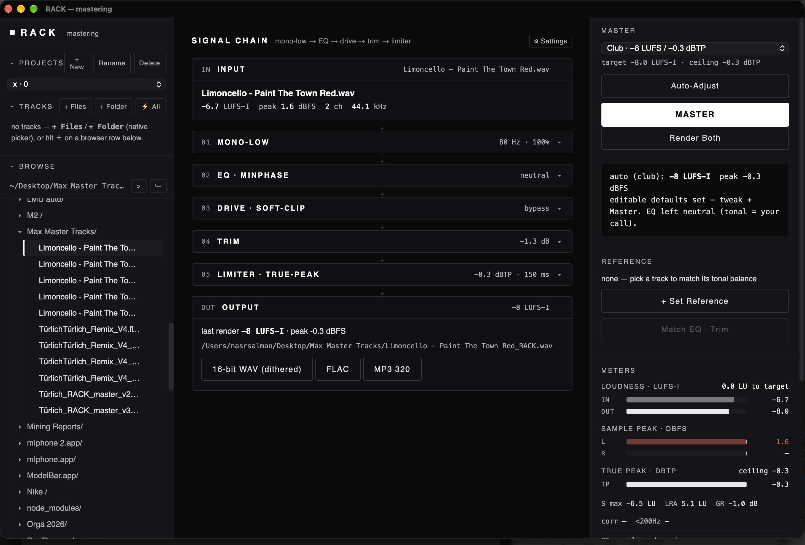

# Nasr Salman

**Building Matheria, Aetheria and Soteria — systems for work, tools for creation and cybersecurity.**

I develop software for professional workflows, operational decisions and creative production. My projects sit in three complementary families: **Matheria** for work and operations, **Aetheria** for creation and expression, and **Soteria** for cybersecurity.

*The Matheria and Aetheria product map; Soteria is described below.*

## Matheria

### Office

| Project | Focus |
| --- | --- |
| **[ApplyFi](projects/applyfi.md)** | Tailored application documents, structured review and layout quality. |
| **[SignalHire](projects/signalhire.md)** | Healthcare and biotech discovery, explainable matching and an application handoff. |

### Finance

| Project | Focus |
| --- | --- |
| **[PoolBoy](projects/poolboy.md)** | Bitcoin-mining operations, earnings reconciliation and reporting evidence. |
| **[2DEXY Full-Stack](projects/2dexy-fullstack.md)** | Trading-system engineering, controlled evaluation and execution boundaries. |

## Aetheria

### Studio

**[Aetheria Studio](projects/aetheria-studio.md)** creates and refines websites through Clone, Composer and Wizard, with Workbench and Social / Sentinel workflows.

The workspace, generator and Python pipeline are components of one Studio product.

### Music

**[Master / RACK](projects/master-rack.md)** shapes electronic-music masters with an editable DSP chain and club / streaming targets. Aetheria Music is a sibling domain with its own processing system.

*RACK application capture, 2 October 2026. [Explore the Music project](projects/master-rack.md).*

## Soteria

**Soteria** is the cybersecurity system. **Phylax** is its assessment and monitoring component. **OSINT & Security Frameworks** remains the separately named **OSINT plugin**, used by Phylax for research and assessments.

Current capabilities include on-demand security assessment workflows, passive organizational OSINT, framework mapping and bounded local evidence tools. Continuous monitoring and automated remediation are not implemented by this structure update.

## How I build

- **Clear responsibilities:** explicit interfaces between products, services and data.
- **Reviewable automation:** visible inputs, editable outputs and deliberate approval steps.
- **Evidence-led engineering:** tests, measurements and dated verification records support capability claims.

The project pages distinguish implemented workflows, active development and research. The source repositories for the six featured Matheria and Aetheria products are private. Soteria adds the cybersecurity family; the OSINT plugin retains its separate private identity. This public portfolio presents product descriptions, selected architecture and a dated application capture.

[Repository guide](REPOSITORIES.md) · [Supporting engineering tools](projects/engineering-tools.md)

*Portfolio organization and featured-source visibility reviewed 20 October 2026. Product status and test results retain their original evidence dates; this review is not a fresh runtime certification.*

*Soteria / Phylax / OSINT plugin structure added 13 November 2026; this is a documentation update, not a runtime security assessment.*
