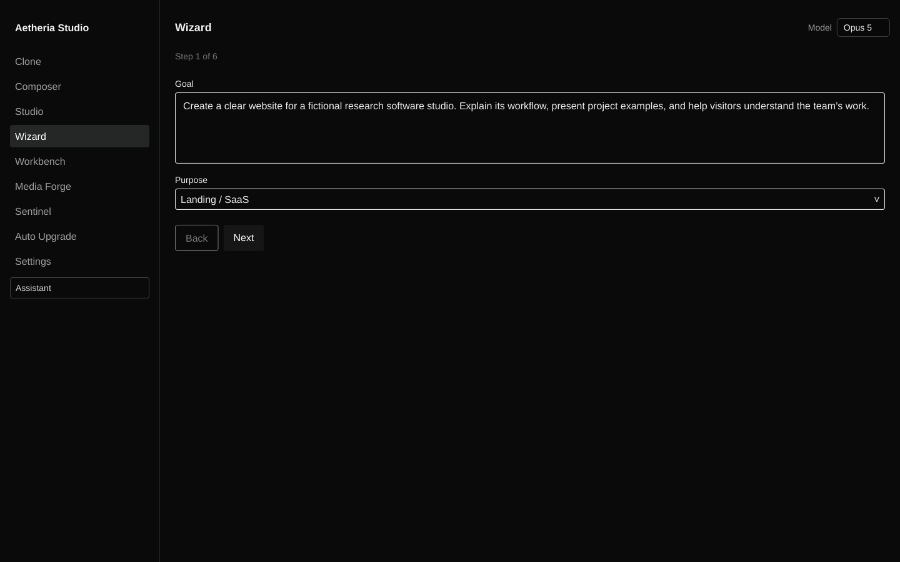

# Nasr Salman

**Operational software · Applied AI · Data reliability**

I develop software that turns fragmented information into reviewable workflows. My focus is reliable data, explicit failure states and automation that keeps people in control of consequential decisions.

My contribution centers on product direction, requirements, development priorities and acceptance criteria, with AI-assisted implementation and review. The case studies explain the system choices, demonstrated behavior and limits of the available evidence.

[Selected work](#selected-engineering) · [Role and engineering evidence](ENGINEERING.md) · [All nine projects](REPOSITORIES.md)

## Selected engineering

### [PoolBoy — operational data and fleet reliability](projects/poolboy.md)

A mining-operations dashboard connecting worker health, earnings reconciliation and cost evidence. The central decision is to keep observations, credited rewards, received payouts and verified costs distinct, so incomplete data stays visible.

**Engineering:** Next.js · TypeScript · PostgreSQL

**Status:** Implemented workflows under active refinement.

*Static preview from private interface components with synthetic data. [Reliability view and case study](projects/poolboy.md).*

### [SignalHire](projects/signalhire.md) & [ApplyFi](projects/applyfi.md) — discovery to reviewed documents

Two complementary workflows: explainable healthcare and biotech opportunity matching, followed by tailored document preparation and review. Source freshness, duplicate handling and factual consistency are explicit concerns. The current handoff is documented separately from the planned durable integration.

**Engineering:** Python · FastAPI · SQLite / FTS5 · document adapters

**Status:** Implemented cores; broader integration remains in development.

### [2DEXY Full-Stack — system boundaries and execution research](projects/2dexy-fullstack.md)

A system separating the operator interface, control and evaluation workflows, and execution engine. The case study examines traceability, accounting, risk gates and recovery across those boundaries.

**Engineering:** Next.js · Python · Rust

**Status:** Active engineering and research; trading readiness and returns are not established by this portfolio.

### [Soteria — security evidence and assessment workflows](projects/soteria-line.md)

Soteria is the cybersecurity system within Soteria Line, with Phylax as its assessment component and OSINT & Security Frameworks as the supporting research plugin. The emphasis is bounded evidence collection, passive research and traceable assessment scope.

**Status:** Documented on-demand assessment scope; broader monitoring and remediation require separate evidence.

## Creative systems

### [Aetheria Studio — structured website creation](projects/aetheria-studio.md)

Clone, Composer and Wizard share template contracts, while generation and knowledge-processing services have explicit responsibilities. The case study explains how reviewable outputs and visible service availability shape the workflow.

*Static Wizard preview with synthetic input; generation and saving were not exercised in this capture.*

### [Master / RACK — inspectable audio processing](projects/master-rack.md)

An editable mastering chain with visible loudness targets and output controls. The engineering focus is predictable DSP behavior and a clear boundary around optional assistance.

*Application capture supplied on 2 October 2026. [Processing decisions and scoped evidence](projects/master-rack.md).*

## Messaging prototypes

- **[Snapp](projects/snapp.md):** an iOS messaging prototype exploring connection persistence, visible delivery state and interruption recovery. A dated historical verification report is distinguished from current runtime evidence.
- **[YEP](projects/yep.md):** a multi-account messaging prototype. Account isolation, queue ownership and controlled recovery are design goals; verified capacity and current device readiness remain open.

## How I work

I define the problem and acceptance criteria, prioritize reliability and integration gaps, and coordinate AI-assisted development. Public technical claims are tied to a specific record or clearly identified as design goals. [Engineering approach, contribution scope and verification](ENGINEERING.md).

The portfolio spans **Matheria** for work and operations, **Aetheria** for creative systems, and **Soteria Line** for cybersecurity. Messaging prototypes are listed separately. [Project and component index](REPOSITORIES.md).

**Application source code stays private.** These pages share selected interface views, architecture and scoped engineering evidence.

*Presentation updated 18 November 2026. Verification records retain their original dates and scope.*
