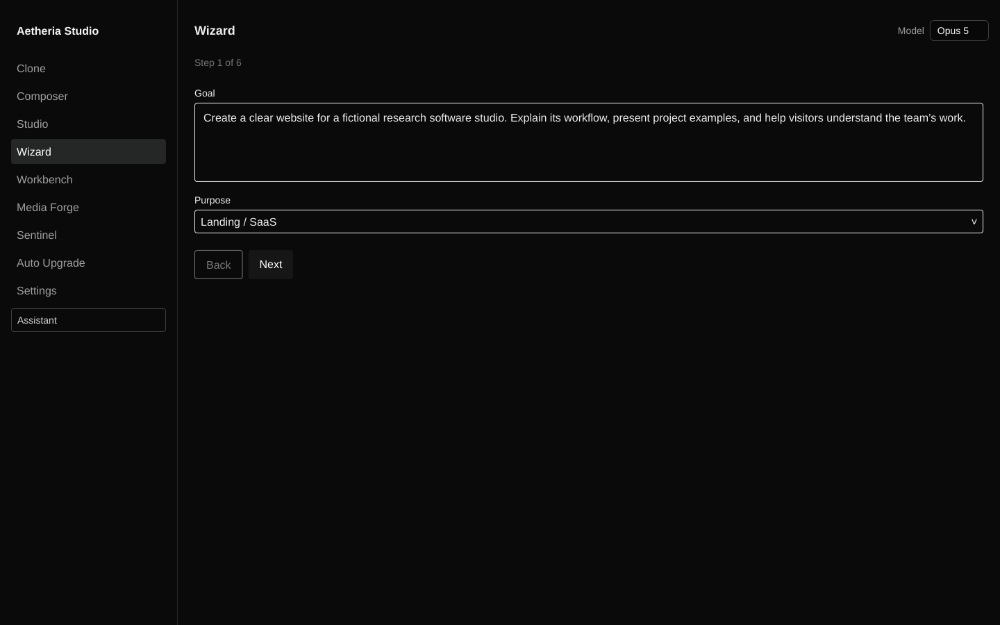
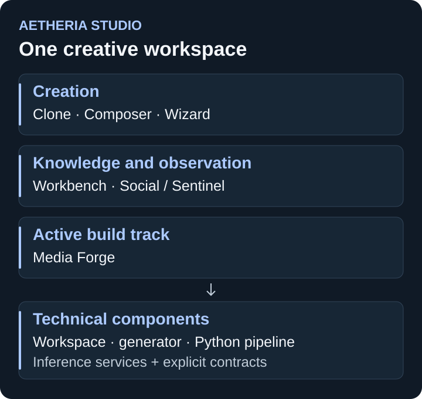

# Aetheria Studio

**Aetheria · Studio · Website creation and creative workflows**

Aetheria Studio is an AI-assisted workspace for creating and refining websites. Clone, Composer and Wizard share reusable template contracts; Workbench provides the knowledge and evaluation workspace. Social / Sentinel adds source observation and evidence review within the same Studio environment.

[Portfolio](../README.md) · [Role and engineering approach](../ENGINEERING.md) · [Music: Master / RACK](master-rack.md)

## Problem and constraints

Website creation spans several entry points: a reference, a structured brief or direct composition. Those paths need compatible outputs so a page can be refined without losing its structure. Generation also depends on services that may be unavailable or return incomplete results. Studio makes shared template contracts and visible service state part of the workspace design.

## Interface preview

*Static preview rendered on 17 November 2026 from the project's private Wizard components with synthetic input. This document-rendered view does not exercise browser interactions, generation, saving or provider services. It is not a running application capture. Implementation code and the preview-generation tooling remain private.*

## Product structure

*Product and component map, not an application screenshot.*

## Implemented design and decisions

**Reuse one template contract.** Clone provides a reference-based starting point; Composer supports section assembly, styles, motion and multi-page refinement; Wizard v1 turns a structured brief into a generated page. Their shared contracts give subsequent editing a consistent foundation.

**Separate workspace and services.** The **Next.js workspace** owns navigation, interaction and orchestration. The **generator** handles website generation; the **Python pipeline** handles extraction, knowledge and evaluation. Inference services have explicit boundaries. This keeps responsibilities clear while making end-to-end integration a separate verification concern.

**Make evidence and availability visible.** Workbench provides source management, corpus visibility and evaluation controls. Social / Sentinel adds local channel continuity, feed observation and evidence review, with coverage varying by source. Health-aware interfaces surface unavailable services. Failed extraction, a pending retry and usable evidence remain distinct states.

## Recent engineering evidence

The **6 September 2026 Studio record** reports 371 specification files and 4,255 tests passing, clean lint / type checks and a successful production build.

The **4 October 2026 local Social / Sentinel rollout record** reports clean lint / type checks, **4,576 tests passing and one skipped**, a successful production build, and responsive fixture / deployed-browser checks. This later evidence concerns local development; it does not establish that every change is included in the GitHub source snapshot.

The reported checks cover named workflows and conditions. Synthetic fixtures remain distinct from real platform acquisition, and a larger retrieval store alone does not demonstrate trained production model weights.

## Development boundaries

Media Forge remains in development, including its complete routing workflow. Broader live-source access, forecast eligibility, model training and Wizard knowledge-store grounding remain separate development directions.

Private corpora, account sessions, creative material and implementation code remain private.
