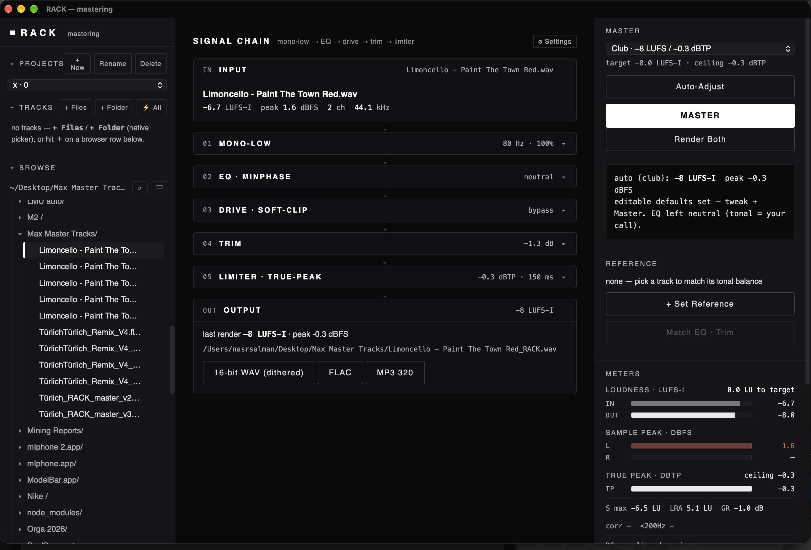

# Master / RACK

**Aetheria · Music · Electronic-music mastering**

Master / RACK is a modular mastering project for techno and electronic music. It makes the processing chain, loudness targets and output decisions visible and editable.

[Portfolio](../README.md) · [Role and engineering approach](../ENGINEERING.md) · [Website creation: Aetheria Studio](aetheria-studio.md)

## Problem and constraints

A mastering workflow needs an audible result and an understandable path to that result. Processing order, level changes and output targets affect the decision. RACK exposes those controls in an editable chain so the user can inspect and adjust the processing.

Browser and desktop paths also create an engineering constraint: shared DSP behavior needs evaluation across different runtimes, while real-time processing must remain responsive.

## Interface view

*Application capture supplied on 2 October 2026. Displayed session measurements are not an independent audio-quality evaluation.*

## What exists

- An editable **mono-low → EQ → drive → trim → limiter** chain.
- Club / streaming targets and input / output loudness meters.
- A C++ DSP core, Web Audio / WebAssembly path and Tauri desktop shell.
- Export controls with WAV, FLAC and MP3 options visible in the captured workspace.

The captured session uses a club target of −8 LUFS / −0.3 dBTP. It shows how the controls and measurements fit together; no copyrighted audio is distributed here.

## Design decisions and evidence

**Keep the chain editable.** Mono-low processing, EQ, drive, trim and limiting have separate controls. Loudness targets and meters make the consequences of those choices visible during the workflow.

**Separate audio processing from optional assistance.** The implemented direction is manual DSP. The engineering target is a processing path free of blocking work. Cross-runtime numerical consistency is a separate verification target. Optional AI assistance belongs outside that real-time path; its integration remains deferred.

The **7 September 2026 maintenance record** documents a repair for child-process output handling, with Rust checks and four tests passing, plus an application rebuild. That receipt supports the specific repair, not a blanket audio-quality or platform-compatibility claim.

## Development status

The maintenance record supports the named repair. Release readiness, cross-runtime numerical consistency and comparative listening quality require their own scoped evaluation. The interface capture establishes the visible workflow, rather than those broader results.

Master / RACK is the Music project within Aetheria. It has its own audio-processing system, separate from Studio's website-creation components. Application source code remains private.
