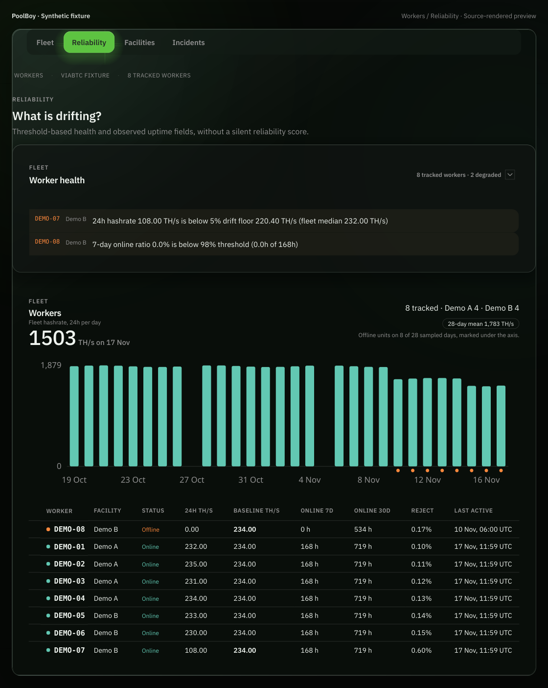

# PoolBoy

**Matheria · Finance · Mining operations**

PoolBoy connects mining-fleet monitoring with earnings reconciliation and reporting. Its central engineering problem is to make machine health and financial records useful together while preserving the difference between observations, estimates and verified evidence.

[Portfolio](../README.md) · [Role and engineering approach](../ENGINEERING.md) · [Trading research](2dexy-fullstack.md)

## Problem and constraints

A hashrate observation, a pool credit, a wallet receipt and a hosting invoice describe different events. Combining them without preserving their origin would hide missing coverage and weaken accounting conclusions. PoolBoy keeps operational observations, credited rewards, balances and cost evidence separate before presenting a combined view.

## Interface views

### Fleet overview

The fleet view brings hashrate, online count, nominal power and efficiency together with individual miner states. The synthetic example includes healthy, degraded and offline machines so the operational differences are visible.

### Reliability and history

The reliability view connects daily fleet hashrate with worker evidence. Missing samples remain gaps, and offline days are marked separately from hashrate values.

*Both views were rendered on 17 November 2026 from the project's private interface components with synthetic demonstration data. These are static document previews. Browser interactions, data collection, account access and database behavior were not exercised; the images are not live operational captures.*

## Implemented design

*Reporting architecture, not a dashboard screenshot.*

**Separate evidence before combining it.** Pool and worker-health collection preserve reward, balance and availability records. Economics views add cost profiles, valuation and reconciliation; invoice review, evidence snapshots and reporting remain explicit workflows.

**Keep uncertainty visible.** Profitability ledgers distinguish complete, partial, estimated and withheld inputs. This can leave gaps in the dashboard, but lets the operator distinguish a missing input from a measured zero.

**Make exceptions inspectable.** Fleet and reliability views connect machine states with dated hashrate and worker records. Operational guidance and the assistant use the dashboard's available evidence.

## Evidence and outcomes

**Stack:** Next.js, React, TypeScript and PostgreSQL, with collection and reporting tooling.

The **2 October 2026 source-publication record** reports a passing typecheck and **3,162 tests passing**. Five listener-dependent tests failed or timed out; the record identifies sandbox listener errors among those failures. Database integration tests, a production build and live runtime checks were outside that publication run.

## Remaining work and boundaries

Monitoring and evidence-aware reporting are implemented and under active refinement. Accounting completeness depends on source coverage and supplied cost evidence. The integration, build and runtime checks excluded from that historical run need separate evidence; these interface previews do not establish their results. Report totals do not independently establish hashing, payout receipt or investment performance.

Public values are synthetic. Real account identifiers, balances, invoices and operational records remain private, together with implementation code and capture tooling.
