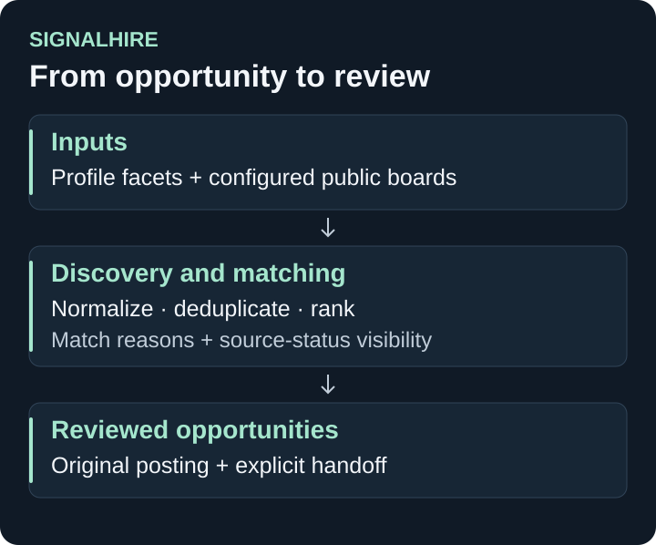

# SignalHire

**Matheria · Office · Opportunity discovery**

SignalHire is a local healthcare and biotech opportunity-discovery workspace. It connects profile setup, configured public job sources, explainable matching and an explicit application handoff in one search flow.

[Portfolio](../README.md) · [Role and engineering approach](../ENGINEERING.md) · [Application creation](applyfi.md)

## Problem and constraints

An opportunity list is useful only if the user can understand why a result matches, inspect its original posting and see whether its source is current. SignalHire addresses that workflow while limiting durable storage of private CV content. External job-board availability remains a dependency, so missing or stale results need visible states.

*Implementation map, not an application screenshot.*

## Implemented design and decisions

**Bound ingestion to configured sources.** Greenhouse and Lever adapters provide bounded ingestion and deduplication. Search caching, explicit refresh and source-failure states make the retrieval boundary visible. Coverage depends on those configured sources; it is not a claim to search every opportunity.

**Make matching inspectable.** The implemented ranking is deterministic, with match explanations and original-posting links. The **Find jobs** workspace includes profile editing, CV import and local job persistence. ML ranking remains future work, so the current matching behavior can be discussed separately from that research direction.

**Minimize retained profile material.** CV content is digested into structured facets. The documented release keeps raw CV text out of durable integration storage and does not send profiles to an AI provider. Structured CV-creator profile/event contracts support an explicit application handoff.

LinkedIn support opens a search link in the user's browser. Separate market-insight workspaces use labelled offline examples; these have a different evidence basis from retrieved job postings.

## Evidence and outcomes

**Stack:** Python, FastAPI, SQLite / FTS5 and a browser workspace.

The **30 September 2026 quality record** reports **64 tests passing**, successful compile and dependency checks, and browser verification of search, profile controls, source failures, keyboard navigation and responsive layouts. It also records point-in-time public-board retrieval.

The documented result is an implemented discovery and matching workflow with reviewed failure and interaction states. These are dated observations, not fresh checks from this portfolio update or a guarantee of future source availability.

## Remaining work

Source expansion, production insight feeds, ML ranking and durable application lifecycle/receipt upgrades remain future work. The existing handoff does not establish an end-to-end ApplyFi integration or automatic application submission. Implementation code and personal profile material remain private.
